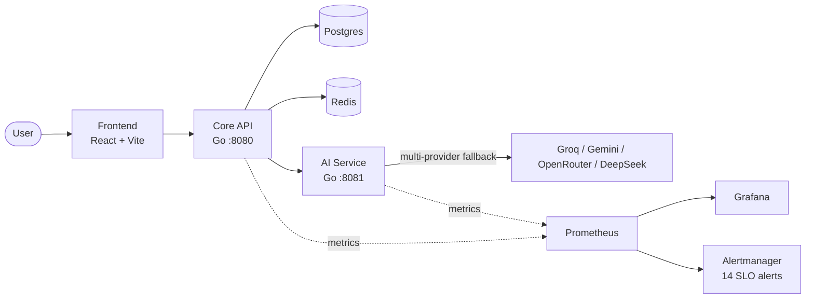
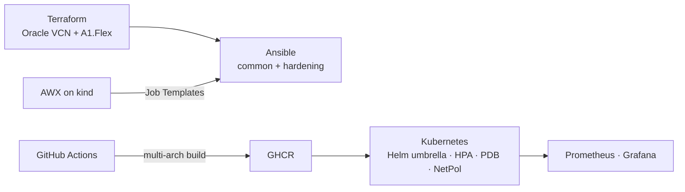

# Ecommerce AI Description Generator

[](https://github.com/bolitaria/ecommerce-ai-description-generator/actions/workflows/ci.yml)
[](https://github.com/bolitaria/ecommerce-ai-description-generator/actions/workflows/infra-ci.yml)


A production-minded microservices platform that generates product descriptions, translations and marketing copy with AI. Ships with multi-provider AI fallback, full Kubernetes packaging, Infrastructure as Code (Terraform + Ansible + AWX), SLO-based observability, and a hardened CI/CD pipeline with required status checks.

## Architecture

### Application



### Deployment pipeline



## Stack

| Layer | Technology |
|---|---|
| Backend | Go 1.24, `net/http`, `pgx` |
| Frontend | React 18, TypeScript, Vite, React Query, Zod |
| Data | PostgreSQL 16, Redis 7 |
| AI | Groq, Gemini, OpenRouter, DeepSeek (fallback chain) |
| Orchestration | Kubernetes (Helm umbrella chart, 3 sub-charts, HPA, PDB, NetworkPolicies, Pod Security Standards) |
| IaC | Terraform (Oracle Cloud), Ansible (`common`, `hardening`), AWX on kind |
| Observability | Prometheus, Grafana, Alertmanager (14 SLO alerts) |
| CI/CD | GitHub Actions, GHCR multi-arch (`amd64` + `arm64`) |
| Testing | `go test -race`, Vitest, `ansible-lint` production, `kubeconform`, `gitleaks` |

## Quick start

```bash
git clone https://github.com/bolitaria/ecommerce-ai-description-generator.git
cd ecommerce-ai-description-generator
cp .env.example .env
docker compose up --build -d
```

Services exposed by Docker Compose:

| Service | URL |
|---|---|
| Frontend | http://localhost:5173 |
| Core API | http://localhost:8080 |
| AI Service | http://localhost:8081 |
| Mock DeepSeek | http://localhost:5001 |

Verify health in one command:

```bash
./scripts/healthcheck.py
# [OK] core-api   (http://localhost:8080/health) status=200 latency=26.9ms attempts=1
# [OK] ai-service (http://localhost:8081/healthz) status=200 latency=1.3ms  attempts=1
```

Prometheus and Grafana are deployed to the kind cluster, not to Docker Compose. See `make help` and `make monitoring-install`.

## Infrastructure as Code

**Terraform** — `infra/terraform/` provisions an Oracle Cloud VCN, subnet and ARM Ampere A1.Flex instance in `eu-madrid-1`. Deployment is blocked by Always Free ARM capacity in that region; the configuration is complete and validated (`terraform fmt -check`, `terraform validate`). See [`docs/oracle-cloud.md`](docs/oracle-cloud.md) for the status.

**Ansible** — `infra/ansible/` contains two container-aware roles:

- `common`: base packages, timezone, swap off, kernel modules (k3s prerequisites)
- `hardening`: UFW, SSH key-only, fail2ban

Both roles are idempotent (verified: `changed=0` on second run) and lint-clean under `ansible-lint` production profile in CI.

**AWX** — `infra/awx/` deploys a self-hosted AWX on a dedicated kind cluster with a reproducible, idempotent `install.sh`. The smoke test (`infra/ansible/tests/awx-smoke.yml`) proves git pull → parse → execute → output → audit end to end. See [`docs/awx.md`](docs/awx.md).

## CI/CD

Two GitHub Actions workflows. Five required checks on `main`:

| Check | Workflow | Validates |
|---|---|---|
| `backend-test` | `ci.yml` | `golangci-lint` + `go test -race` with Postgres service |
| `frontend-test` | `ci.yml` | `npm run lint` + `npm run build` |
| `helm-validate` | `ci.yml` | `helm lint`, `helm template`, `kubeconform -strict` |
| `ansible-lint` | `infra-ci.yml` | Ansible production profile on `infra/ansible/**` |
| `secret-scan` | `infra-ci.yml` | `gitleaks` on every push and PR |

`terraform-check` (fmt + validate) runs on `infra/terraform/**` changes but is not yet required — its real path has not been exercised in CI.

Multi-arch images (`linux/amd64`, `linux/arm64`) are built natively via `--platform=$BUILDPLATFORM` in the build stages, avoiding QEMU. QEMU made `npm install` take hours; the fix is documented in [PR #13](https://github.com/bolitaria/ecommerce-ai-description-generator/pull/13).

## Observability

Prometheus scrapes core-api and ai-service. Grafana ships dashboards for latency, request rate, error rate and AI provider fallback rates. Alertmanager fires on 14 SLO-based rules (availability, latency p95, provider failure, saturation). Alerts are validated in CI with `promtool`.

## Testing

```bash
make test          # go test ./...
make lint          # golangci-lint
make helm-lint     # helm lint + kubeconform
make verify-alerts # promtool check rules

./scripts/healthcheck.py
python3 -m unittest scripts/test_healthcheck.py -v
cd infra/ansible && ansible-lint
```

`healthcheck.py` is a stdlib-only probe for both Go services, with exponential backoff, JSON output, and exit codes usable from CI or AWX.

## Repository layout

```
cmd/            Go entry points
internal/       Domain, services, repositories, middleware
ai-service/     AI microservice (Go)
web/            React + TypeScript frontend
helm/           Umbrella chart + 3 sub-charts + library chart
k8s/            kind cluster config
infra/          ansible/ · terraform/ · awx/
scripts/        Build, migrate, deploy, test, healthcheck.py
docs/           Architecture, runbook, AWX, Oracle Cloud, versioning
.github/        ci.yml · infra-ci.yml · release.yml
```

## Documentation

- [`docs/architecture`](docs/architecture) — service boundaries, data flow
- [`docs/awx.md`](docs/awx.md) — AWX deployment, known issues, demo
- [`docs/oracle-cloud.md`](docs/oracle-cloud.md) — Terraform status and blockers
- [`docs/runbook.md`](docs/runbook.md) — incident response playbook
- [`docs/versioning.md`](docs/versioning.md) — release and semantic versioning
- [`docs/professional-profile.md`](docs/professional-profile.md) — the "why" behind the project

## Roadmap

- Custom AWX Execution Environment with `ansible-core 2.16` + `community.general 8` (default EE ships `2.15.12`, incompatible with the collection pin)
- `k3s` Ansible role (blocked by Oracle ARM capacity, tracked in `docs/oracle-cloud.md`)
- Wire `healthcheck.py` as a pre-step in `test-stack.sh` for fast-fail
- Promote `terraform-check` to required check once its real path is verified in CI

## License

MIT
